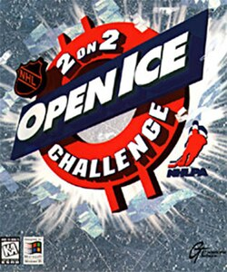

# NHL Open Ice for Analogue Pocket



An experimental openFPGA port of **NHL Open Ice: 2 on 2 Challenge**, revision **1.21**, for Analogue Pocket. Based on [blahm1d/wolf-unit](https://github.com/blahm1d/wolf-unit), with Pocket-specific memory, loading, video, audio and controller integration.

[Instructions en français](README.fr.md)

Version **0.1.0-test.5** has been tested on a physical Pocket. The tester confirmed smoother gameplay and a working title-screen loading display on 25 October 2026. Boot, credits, gameplay and sound were established in the earlier test.4 release. This remains a community test release; arcade accuracy and extended stability are not established. No game ROMs are included.

Test.5 replaces the striped loading screen with the title image, a progress bar and a percentage based on completed asset transfers. Memory optimizations reduce CPU waits, speed up aligned RAM writes, cache program words and group dense graphics reads. CPU, video, memory and audio clock rates are unchanged. The reported improvement in gameplay is qualitative; no frame-rate gain or exact arcade-speed claim is made.

## Install

1. Download **`auricom79.OpenIce_0.1.0-test.5.zip`** from [Releases](https://github.com/auricom79/openfpga-openice/releases). The automatically generated GitHub source archives are for development.
2. Extract the release ZIP into the root of the Pocket microSD card, merging `Cores`, `Platforms` and `Assets`. The core folder is `Cores/auricom79.OpenIce`.
3. Supply your own **Open Ice revision 1.21** ROM set, either `openice.zip` or an extracted directory. Prepare the assets with Python 3.9 or newer. No extra Python packages are needed.

   From a source checkout:

   ```sh
   python3 tools/prepare_roms.py /path/to/openice.zip --output /path/to/SD/Assets/openice/common
   ```

   The release ZIP also includes the tool. For a macOS SD card mounted as `BOOT`:

   ```sh
   python3 /Volumes/BOOT/Cores/auricom79.OpenIce/tools/prepare_roms.py ~/Downloads/openice.zip --output /Volumes/BOOT/Assets/openice/common
   ```

   Windows example:

   ```powershell
   py -3 E:\Cores\auricom79.OpenIce\tools\prepare_roms.py C:\ROMs\openice.zip --output E:\Assets\openice\common
   ```

   Replace the paths or drive letter with your own. The script checks all 22 ROM files by size, CRC32 and SHA-1, then checks the SHA-256 of each prepared stream. It does not download ROMs or modify the originals. A different revision will be rejected. It refuses to overwrite different existing assets.

4. The asset directory must contain:

   | File | Bytes |
   | --- | ---: |
   | `openice-program.bin` | 1,048,576 |
   | `openice-graphics.bin` | 16,777,216 |
   | `openice-sound.bin` | 4,194,304 |

5. Safely eject the card, insert it in the Pocket and select **openFPGA → NHL Open Ice**.

The title image, progress bar and percentage remain visible while the game files load. Wait for loading to finish without opening the menu. **100% means the asset transfer is complete**; the game then performs its own startup checks. Existing prepared game files can be reused when upgrading.

## Start playing

On a fresh boot, `CMOS INVALID — FACTORY SETTINGS RESTORED` may appear because persistent CMOS saving is not implemented. Press a game button to continue.

The factory settings require **two credits to start**. Press **Select** several times, releasing it between presses, then press **Start**. Four separated Select presses followed by Start worked in hardware testing. Use **B** to confirm menu choices, including the initials prompt.

| Pocket control | Game action |
| --- | --- |
| D-pad | Move / select |
| A | Turbo |
| B | Shoot / block; confirm menus |
| X | Pass / steal |
| Select | Insert coin |
| Start | Start / join |

If an apparent stuck screen persists, try a complete Pocket power-off and restart, then allow loading to finish. An earlier report of a fixed statistics screen was resolved by that sequence; its exact cause was not established.

## Status and limitations

- Smoother gameplay and the loading display were confirmed on Pocket for test.5 on 25 October 2026. The improvement has not been quantified, and camera behavior has not been separately measured against an arcade board.
- Startup duration depends on asset loading and the game’s own checks; the progress indicator covers asset loading only.
- CMOS settings and records are not saved between sessions. Save states and sleep are not supported.
- Dock capability is declared in the APF metadata and two controllers are mapped, but Dock, multiplayer and analog output have not been validated; analog output is disabled.
- Only revision 1.21 is supported by the asset preparation tool. Other Wolf Unit games are not supported by this release.
- Full-match completion, extended stability and arcade timing fidelity are not yet independently verified.

Report reproducible problems through [Issues](https://github.com/auricom79/openfpga-openice/issues), including core version, Pocket firmware, boot or gameplay stage, controls used and whether sound is affected. Do not attach game ROMs.

## Development and credits

See [BUILDING.md](BUILDING.md) for the corresponding source snapshot and Quartus build instructions. The released FPGA bitstream is identical to the test.5 image validated by the tester; the release includes its corresponding sources.

- **blahm1d and Wolf Unit contributors** — original [Wolf Unit FPGA implementation](https://github.com/blahm1d/wolf-unit).
- **Kevin Coleman** — TMS34010 core.
- **Sorgelig and MiSTer contributors** — reused SDRAM and framework work.
- **Adam Gastineau (agg23)** — Analogue Pocket utilities.
- **Analogue** — openFPGA framework and core template.
- **MAME developers** — hardware reference and ROM identification metadata.
- **auricom79** — Pocket port project and hardware testing, developed with assistance from OpenAI Codex.

The combined project follows the upstream GPL-3.0 declaration; individual MIT, APF and Intel notices remain in place. See [NOTICE.txt](NOTICE.txt), [LICENSE](LICENSE), and `licenses/`. This is an unofficial community project, not affiliated with Analogue, Midway or the NHL. Supply your own game data; no ROM download service is provided.
